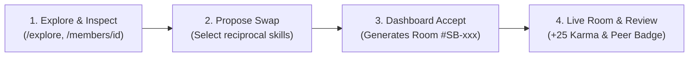

# SkillBridge: Presenter's Demo, Theory & Evaluation Guide

> **Tagline:** *Share. Learn. Repeat.*  
> **Philosophy:** *Skill for Skill • Zero Monetary Barrier • Hyper-Local Knowledge Exchange*  
> **Target Audience:** Presenters, Faculty Evaluators, Hackathon Judges, and Community Organizers.

---

## 1. The 30-Second Opening Pitch
*(Verbatim speech for starting the presentation)*

> "Good morning/afternoon. Today I am presenting **SkillBridge** — a hyper-local, community skill-exchange platform. Our tagline is **'Share. Learn. Repeat.'**  
> 
> Most online education today is locked behind expensive paywalls and consists of passive, pre-recorded videos where you learn alone. Meanwhile, our neighborhoods and college campuses are full of untapped wisdom: a senior citizen who knows terrace gardening, an engineer who knows Python, or an artist who paints watercolors.  
> 
> SkillBridge connects neighbors to trade skills **one-on-one without money**. We use a civic point system called **Karma Points** and a **6-Factor Matching Engine** that pairs people based on what they want to teach and what they want to learn."

---

## 2. Complete End-to-End App Flow (The 4-Step Live Demo)



### Step 1: Discover & Member Inspection (`/explore` or `/matches`)
* **What is shown:** A searchable directory of community neighbors (e.g., Kavita Nair, Ramesh Kulkarni) displaying their skills, location, and match percentages.
* **How it works:** Clicking any member's card or avatar navigates to their **Public Member Profile (`/members/[id]`)**.
* **Presenter Explanation:**  
  *"Before proposing a swap, users inspect their neighbor's bio, verified credentials, and testimonials left by other community members, establishing mutual safety and trust."*

### Step 2: Proposing a Skill Swap
* **What is shown:** Clicking **"Propose Swap"** opens a modal where the user selects:
  1. The skill they wish to learn from the member.
  2. The skill they offer to teach in return.
  3. Preferred time/day and a personal note.
* **How it works:** Submitting the proposal triggers an asynchronous state update with an animated loading spinner and visual toast notification. The proposal is registered in the persistent store with a `pending` status.

### Step 3: Managing Requests on the Dashboard (`/dashboard`)
* **What is shown:** The de-congested dashboard featuring a hero card with the next upcoming exchange and an **"Action Required"** tab.
* **How it works:** Incoming and outgoing proposals appear in real time. Clicking **"Accept Swap"** synchronously:
  1. Updates the proposal status to `accepted`.
  2. Schedules an upcoming session.
  3. Dynamically generates a secure workspace link (e.g., `/room/sb-room-101`).

### Step 4: The Live Workspace & Karma Completion (`/room/[id]`)
* **What is shown:** The collaborative exchange room with simulated video feeds, shared collaborative notes, and a session timer.
* **How it works:** Clicking **"End Session"** launches a completion dialog where partners rate each other (1–5 stars) and assign qualitative peer badges (e.g., *"Patient Mentor"*).
* **The Result:** The system awards **+25 Karma points** to the teacher, logs a financial-grade entry in their private **Karma Ledger (`/profile`)**, and immediately appends the review to the member's public profile.

---

## 3. Core Mechanics & Algorithmic Theory

### 3.1 The 6-Factor Deterministic Matching Engine
Matches are not random; they are calculated using a weighted 0–100% compatibility algorithm:

$$\text{Total Score} = S_{\text{reciprocal}} + S_{\text{level}} + S_{\text{location}} + S_{\text{availability}} + S_{\text{format}} + S_{\text{trust}}$$

| Factor | Weight | Explanation |
|:---|:---:|:---|
| **Reciprocal Skill Match** | **40%** | Person A teaches what Person B wants to learn, AND vice versa. |
| **Skill Level Complementarity**| **20%** | Higher scores when an Advanced/Intermediate mentor pairs with a Beginner learner. |
| **Location Proximity** | **15%** | Higher scores for members living within the same neighborhood or campus zone (5–10 km). |
| **Availability Overlap** | **10%** | Both members are free during the same windows (e.g., weekend mornings). |
| **Format Agreement** | **10%** | Both members agree on In-Person, Online Video, or Hybrid learning. |
| **Community Trust Rating** | **5%** | Boosted by high star ratings and on-time session completion history. |

### 3.2 The Karma Economy & Anti-Freeloader Rules
* **Starter Allowance:** Every new account starts with **100 Karma points**.
* **Earning Points:** Members earn **+25 Karma** per 1-hour teaching session or by solving community doubts on the Problem Board (`/community`).
* **Spending Points:** Booking a learning session costs **25 Karma**.
* **Direct Barter Exemption:** When two neighbors engage in a direct 1-to-1 reciprocal swap (30 mins teaching / 30 mins learning), the **net cost is 0 Karma**.
* **Minimum Balance Lock:** If a user's balance drops below 25 points, the platform locks their ability to request sessions. They must teach or answer community questions to earn credits before learning again.
* **Anti-Hoarding Decay:** Accounts inactive for >90 days experience a gentle decay of 5 points/month back into the community pool.

### 3.3 Storage Architecture: The Enterprise Repository Pattern
* **How it works:** State is managed via a centralized `SwapContext` backed by browser `localStorage`.
* **Why it matters:** The UI interacts purely with abstract service methods (`createProposal`, `acceptProposal`, `completeSession`).
* **Architectural Advantage:** When migrating to a production cloud database (such as PostgreSQL or Supabase), **zero UI components need modification**. Only the internal fetch logic within the repository layer is updated.

---

## 4. Tech Stack & Libraries Inventory

| Technology / Library | Role in Plain English | Purpose in SkillBridge |
|:---|:---|:---|
| **Next.js 14 (App Router)** | Full-Stack Web Framework | Provides server-side rendering, layout nesting, and fast route handling (`/members/[id]`, `/room/[id]`). |
| **React 18** | UI Component Architecture | Manages component lifecycles, progressive disclosure tabs, and interactive modals. |
| **TypeScript** | Strongly Typed Language | Guarantees data integrity across contracts (`User`, `SwapProposal`, `SwapSession`, `KarmaTransaction`). |
| **Tailwind CSS** | Design Token Engine | Implements a warm, accessible anti-AI color palette (Burgundy, Peach, Cream) with zero CSS bloat. |
| **Lucide React** | Iconography Suite | Delivers lightweight, accessible SVG visual cues for badges, ratings, and navigation. |
| **Sonner** | Toast Notification System | Provides instant, non-intrusive feedback on asynchronous actions (proposal sent, points awarded). |
| **clsx & tailwind-merge** | Class Name Utilities | Conditionally merges Tailwind utility classes without specificity bugs. |
| **Web Storage API (`localStorage`)** | Client-Side Persistence Layer | Retains session state, ledger history, and proposals across browser refreshes and tab navigations. |

---

## 5. Defense Q&A: Top Evaluator Questions Answered

### Q1: "Why would an expert waste time teaching a beginner for free?"
> **Answer:** *"Because nobody is an expert at everything! A senior software engineer with 10 years of experience still might not know how to cultivate bonsai trees, play acoustic guitar, or bake sourdough bread. SkillBridge lets professionals trade their vocational knowledge for life skills and wellness hobbies they personally desire."*

### Q2: "What prevents users from submitting fake reviews to inflate ratings?"
> **Answer:** *"Reviews are cryptographically tied to unique session identifiers (`#SB-xxx`). You cannot post a review for a user without an accepted proposal, an active room exchange, and a mutual completion confirmation."*

### Q3: "How does the platform handle safety, harassment, or no-shows?"
> **Answer:** *"We use a 3-layer trust architecture:  
> 1. In the room, an Emergency Exit & Flag button immediately halts point transfers and flags the exchange for community review.  
> 2. Unexcused no-shows trigger an automatic deduction of 20 Karma points.  
> 3. Trust Scores drop when a user cancels repeatedly, freezing booking access if reliability falls below 80%."*

### Q4: "How does SkillBridge align with real-world social impact?"
> **Answer:** *"SkillBridge maps directly to four UN Sustainable Development Goals:  
> * **SDG 4 (Quality Education):** Provides continuous, barrier-free informal education.  
> * **SDG 10 (Reduced Inequalities):** Democratizes access to high-value skills without monetary constraints.  
> * **SDG 11 (Sustainable Communities):** Fosters hyper-local neighborhood resilience and intergenerational connection.  
> * **SDG 3 (Good Health & Well-Being):** Reduces social isolation among seniors and remote workers through active human exchange."*

### Q5: "How do you solve the cold-start problem when launching in a new neighborhood?"
> **Answer:** *"Through a 4-phase launch playbook:  
> 1. Onboard 15–20 anchor mentors via local community groups, senior recreation clubs, and campus societies.  
> 2. Deploy physical QR flyers in community elevators and libraries.  
> 3. Allow new users to engage first via the low-friction Neighborhood Problem Board (`/community`).  
> 4. Trigger algorithmic reciprocal matchmaking once liquidity reaches 50 registered members."*

---

## 6. Presenter's Emergency Reset Protocol

If test data becomes cluttered before or during an evaluation:
1. Open Developer Tools (`F12`).
2. Open the **Console** tab.
3. Execute:
   ```javascript
   localStorage.clear(); location.reload();
   ```
4. The application will instantly re-seed with pristine demo personas (Pooja Sharma, Kavita Nair, Ramesh Kulkarni) and default pending proposals within 2 seconds.
