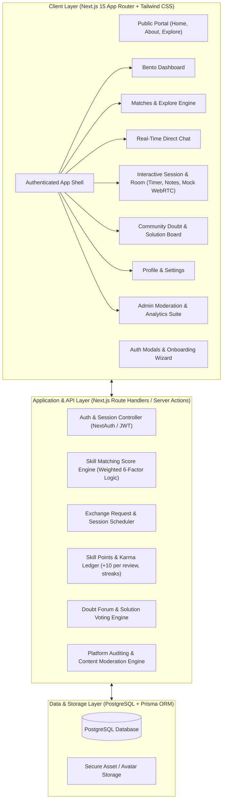
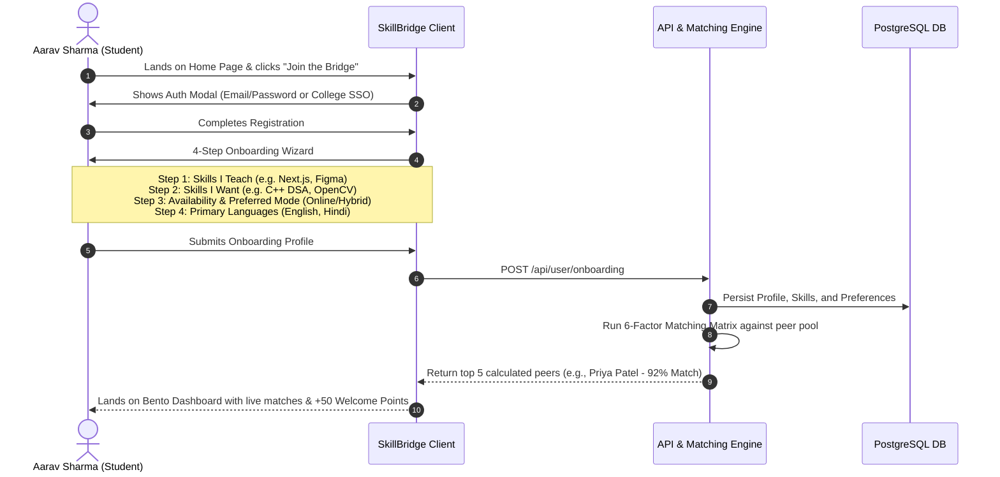
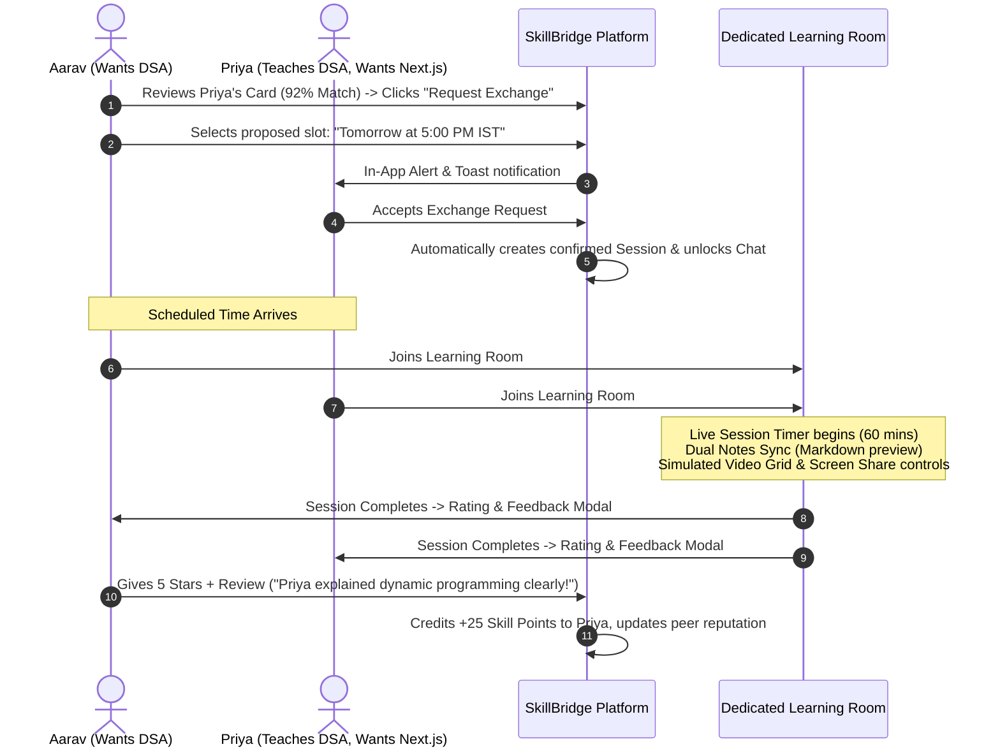
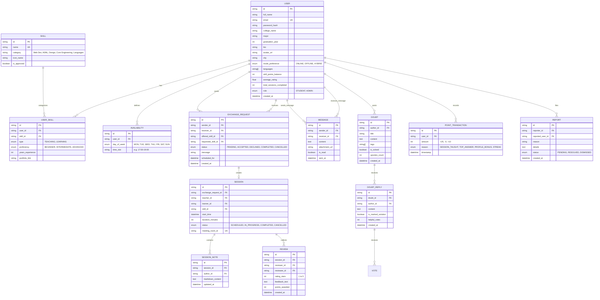

# 🏛️ SkillBridge — Master Architectural Blueprint & Roadmap

> **Tagline:** *"Share. Learn. Repeat."*  
> **Mission:** Community-driven, zero-mandatory-cost peer-to-peer knowledge exchange for college students.  
> **Core Concept:** *"I know something you want to learn, and you know something I want to learn."*

---

## 1. System Philosophy & Anti-AI Realism Guardrails

SkillBridge is built as a Community Engagement Project (CEP) engineered to production-grade SaaS standards. To prevent the "cheap generic template" look, every interface, dataset, and interaction is bound to these standards:

- **Persona Realism:** Indian engineering campus demographics (e.g., Aarav Sharma from IIT Bombay, Priya Patel from VJTI, Rohan Verma from BITS Pilani). Realistic tech-stack pairings (e.g., teaching *React & Tailwind* while learning *Data Structures & Algorithms in C++* or *System Design*).
- **Design Tokens:**
  - **Background / Canvas:** Warm Cream (`#FDFBF7`)
  - **Surfaces / Cards:** Pure Crisp White (`#FFFFFF`)
  - **Brand Primary:** Deep Burgundy / Wine (`#722F37`), hover: `#5A252C`
  - **Accents & Badges:** Soft Peach (`#FFB085`) and Light Almond (`#FFE8D6`)
  - **Typography:** Plus Jakarta Sans & Inter
  - **Headings & Text:** Dark Slate (`#2D3748`) and Muted Grey (`#718096`)
- **Micro-Interactions & Structure:**
  - Glassmorphic navigation headers (`backdrop-blur-md bg-[#FDFBF7]/80`)
  - Bento-grid responsive dashboard modules
  - Diffused multi-layer drop shadows (`shadow-[0_8px_30px_rgb(0,0,0,0.04)]`)
  - Organic rounded radii (`rounded-2xl`, `rounded-3xl`)
  - Shimmering skeleton loaders (no raw spinning spinners)
  - Calculated algorithmic compatibility badges (e.g., `94% Match`, `81% Match`)

---

## 2. Part A: Complete Application Architecture & User Flow

### 2.1 High-Level Architecture Diagram

---

### 2.2 End-to-End User Journeys

#### Journey 1: New Student Onboarding & Matching

#### Journey 2: Skill Exchange Request to Learning Room

---

## 3. Part B: Database ER Diagram & Schema Specifications

### 3.1 Relational Entity-Relationship Diagram

---

## 4. Part C: Recommended Tech Stack for a 4-Person Student Team

### 4.1 Team-Friendly, Zero-Headache Stack Matrix

| Layer | Recommended Choice | Rationale for a 4-Person Student Team |
| :--- | :--- | :--- |
| **Framework** | **Next.js 15 (App Router)** | Full-stack in one repo. Frontend UI and backend API routes in TypeScript eliminate cross-repo synchronization friction. |
| **Language** | **TypeScript 5** | Strict type definitions prevent runtime bugs across teammates. Autocomplete speeds up development for beginners. |
| **Styling & UI** | **Tailwind CSS + Lucide Icons + Tailwind Variants** | Rapid styling with custom palette tokens (`#722F37`, `#FDFBF7`, `#FFB085`). Zero heavy CSS files to maintain. |
| **Database & ORM** | **Prisma ORM with SQLite (Local Dev) → PostgreSQL (Supabase/Neon)** | Team can clone and run `npx prisma db push` instantly on local SQLite without needing a heavy local Docker or Postgres setup on day one, then switch 1 line of config to deploy to Neon/Supabase for production. |
| **Authentication** | **NextAuth.js (Auth.js) / Secure Session Cookies** | Industry standard, zero ongoing SaaS fee, supports credentials and Google/GitHub OAuth easily. |
| **State & Fetching** | **React Hooks + SWR / Server Actions** | Minimal boilerplate, automatic optimistic UI updates, zero Redux bloat. |
| **Media / Virtual Room** | **WebRTC Mock UI + Live Timer & Sync Notes Engine** | Interactive meeting suite with real webcam/mic toggling, screen-share preview, live dual-pane collaborative notes, and countdown timers. |
| **Deployment** | **Vercel + Neon PostgreSQL / Supabase** | 100% free-tier eligible for college project presentations; automated CI/CD directly from GitHub on every pull request. |

### 4.2 4-Person Workload Division
- **Developer 1 (Architect / Full-Stack Lead):** Database schema, NextAuth configuration, Matching Algorithm logic, API Route handlers.
- **Developer 2 (UI/UX & Design System Lead):** Global layout, warm-cream/burgundy theme tokens, Public Pages (Home, About, Explore), Bento Dashboard components.
- **Developer 3 (Core Interaction Lead):** Profile Onboarding wizard, Exchange Request flow, Private Chat messaging, and Session Scheduling modals.
- **Developer 4 (Features & Engagement Lead):** Interactive Learning Room (Timer, Notes, Mock Controls), Post-Session Feedback & Points Ledger, Community Doubt Forum, and Admin Panel.

---

## 5. Part D: 6-Factor Matching Algorithm Mathematical Specification

The match score between User $A$ (learner) and User $B$ (potential mentor) is computed on a scale of $0$ to $100$:

$$\text{Total Match Score} = S_{\text{skill}} + A_{\text{avail}} + L_{\text{lang}} + C_{\text{level}} + M_{\text{mode}} + R_{\text{points}}$$

Where:
1. **Skill Compatibility ($S_{\text{skill}} \in [0, 50]$ pts):**
   - Direct mutual match ($A$ wants what $B$ teaches AND $B$ wants what $A$ teaches): $50$ pts.
   - One-way match ($B$ teaches what $A$ wants): $35$ pts.
   - Related category match: $20$ pts.
2. **Availability Overlap ($A_{\text{avail}} \in [0, 15]$ pts):**
   - Shared free day/time slot: $15$ pts ($5$ pts per overlapping window up to $15$).
3. **Language Match ($L_{\text{lang}} \in [0, 10]$ pts):**
   - At least 1 shared spoken language: $10$ pts.
4. **Level Compatibility ($C_{\text{level}} \in [0, 10]$ pts):**
   - Mentor level is strictly greater than or equal to learner's current target level: $10$ pts; otherwise $5$ pts.
5. **Mode / Location Preference ($M_{\text{mode}} \in [0, 10]$ pts):**
   - Exact mode match (Online-Online, or same campus offline): $10$ pts; Hybrid: $7$ pts; Mismatch: $0$ pts.
6. **Reputation & Points Momentum ($R_{\text{points}} \in [0, 5]$ pts):**
   - High rating ($\ge 4.5/5$) and active peer reviews: $5$ pts.

---

## 6. Part E: Master 17-Phase Development Roadmap

| Phase | Milestone | Core Deliverables |
| :--- | :--- | :--- |
| **Phase 1** | **Repository Foundation & Design System** | Next.js 15 + Tailwind CSS setup, custom color palette (`#FDFBF7`, `#722F37`, `#FFB085`), typography, Lucide icons, button variants, and base Card components. |
| **Phase 2** | **Prisma Database Schema & Seed Data** | Comprehensive Prisma schema (12 tables), SQLite/PostgreSQL setup, realistic seed dataset with 10 authentic Indian engineering student profiles and diverse skill portfolios. |
| **Phase 3** | **Public Landing Page & Navigation** | High-converting Hero section with dynamic floating cards, "How it Works" 3-step carousel, live community stats, student testimonials, and responsive glassmorphic navbar/footer. |
| **Phase 4** | **About Us & Philosophy Page** | Story of SkillBridge, peer-to-peer manifest, "Zero Mandatory Money" ethos, interactive comparison table (SkillBridge vs paid EdTech). |
| **Phase 5** | **Authentication System** | Clean modal-driven Sign-In and Sign-Up flows, college email validation, password reset mockup, and persistent mock session provider. |
| **Phase 6** | **Multi-Step Profile Onboarding Flow** | 4-step progressive wizard (Skills to Teach, Skills to Learn, Availability Grid, Preferred Mode & Languages) with instant validation and completion progress bar. |
| **Phase 7** | **Bento-Grid Student Dashboard** | Dashboard hub: Recommended peer matches, upcoming session countdown, pending incoming/outgoing requests, Skill Points balance widget, and live notification drawer. |
| **Phase 8** | **Explore Skills & Directory Engine** | Full search catalog, filter by category (AI, Web, Design, DSA, Core Eng), filter by proficiency level, sort by rating/points, and mentor detail previews. |
| **Phase 9** | **Algorithmic "My Matches" Hub** | Dedicated matching screen showcasing calculated match percentages ($84\%$, $92\%$), breakdown tooltip (Skills, Availability, Language), and instant "Request Exchange" CTA modal. |
| **Phase 10** | **Real-Time Direct Chat & File Sharing** | WhatsApp/Slack-grade dual-pane chat interface, peer list, message bubbles, active status, mock attachment uploader, and quick "Propose Session" button. |
| **Phase 11** | **Exchange Request & Scheduling Flow** | Date/time picker modal, skill selection dropdown, invitation state management (Pending $\rightarrow$ Accepted $\rightarrow$ Scheduled), and calendar integration. |
| **Phase 12** | **Interactive Learning Room Suite** | Dedicated room view with mock video/audio stream toggles, screen-share preview, real-time 60-minute countdown timer, dual-pane markdown notes editor, and in-room chat sidebar. |
| **Phase 13** | **Post-Session Review & Skill Points Engine** | 5-star rating modal, tags for peer feedback ("Patient", "Great Visuals", "Clear Explanations"), automatic +25 points credit, and points ledger history. |
| **Phase 14** | **Community Doubt & Problem Board** | StackOverflow-inspired college doubt forum: post a question, filter by tags (Recursion, Next.js, Dynamic Programming), upvote answers, mark verified solution, and earn karma. |
| **Phase 15** | **Comprehensive User Profile** | Public/Private profile view: skills taught/learning badges, student bio, college badge, verified session tally, points ranking, and peer reviews list. |
| **Phase 16** | **Settings & Security Suite** | Account management, privacy toggles (hide profile from public search), notification preferences (email/in-app), password change, and session logout. |
| **Phase 17** | **Admin Control & Moderation Suite** | Executive dashboard: total users, active exchanges, platform health metrics, skill taxonomy manager, and user moderation/report resolution panel. |

---

## 7. Approval Checkpoint

This completes the comprehensive blueprint for **SkillBridge**.  
Upon your explicit approval:
1. We will begin directly with **Phase 1 (Repository Foundation & Design Tokens)**.
2. Every file will be built cleanly with its full path, complete code, exact terminal installation commands, and step-by-step verification instructions.
